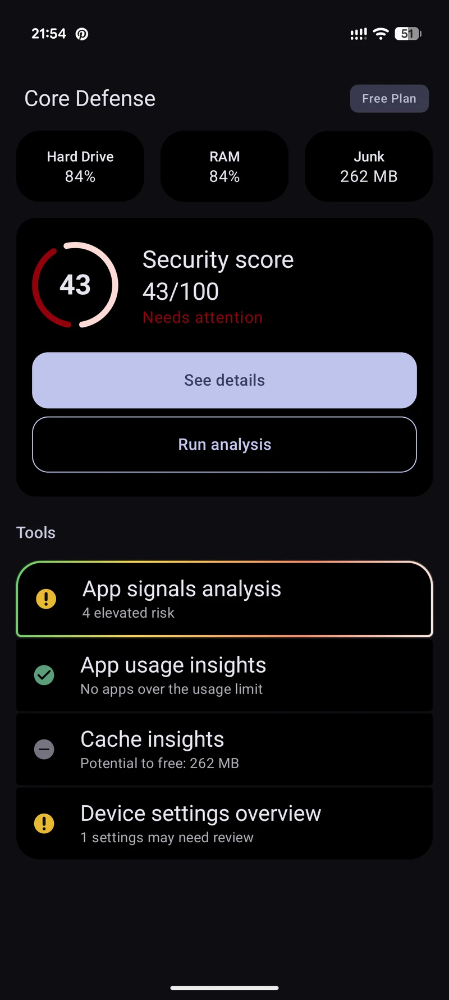
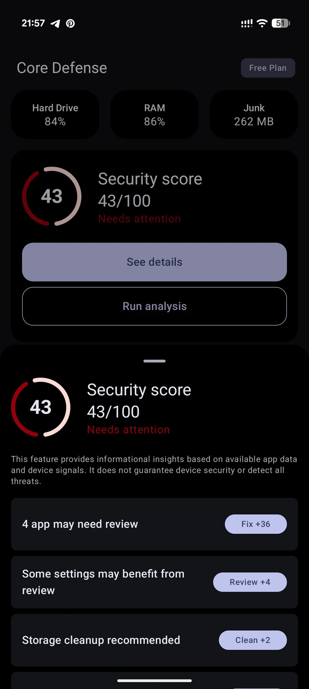
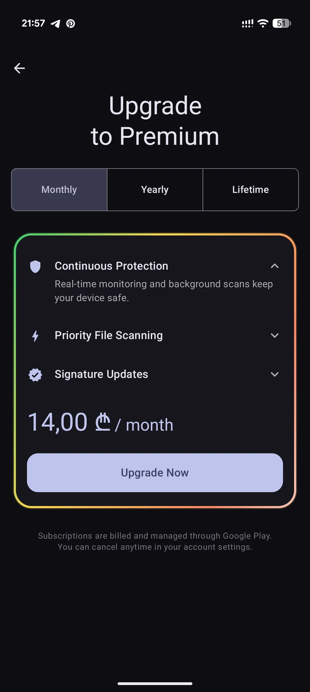

# Core Defense — Android engineering case study

Native Android defender app that brings device security signals, an explainable score, reviewable insights, and subscription features into one interface.

**[Full case study ↗](https://byfedin.dev/core-defense) · [Watch the 22-second demo ↗](https://byfedin.dev/core-defense#demo-title)**

## My contribution

**Full Android development · Galaksion’s internal mobile studio**

I owned Android development across architecture, Compose UI, on-device analysis, subscription integrations, analytics, signing, and release delivery.

**Platform:** Android  
**Delivery:** Google Play release delivery  
**Stack:** Kotlin · Jetpack Compose · Coroutines & Flow · Google Play Billing · Firebase · AppMetrica · Remote Config

## The application

- A device dashboard with a Security Score and summary statistics.
- App signals analysis, usage and cache insights, and a device settings overview.
- A score breakdown connecting the summary to reviewable items.
- Monthly, yearly, and lifetime plan options in the native Premium interface.

<table>
<tr>
<td align="center"> Device overview</td>
<td align="center"> Security Score breakdown</td>
<td align="center"> Premium subscription plans</td>
</tr>
</table>

Actual app captures from a Pixel 9 Pro XL. Open the full case study for larger screenshots and the device walkthrough.

## Engineering work

### On-device scoring

I developed a custom scoring engine using 20+ behavioral and permission-based signals on a 0–100 scale. The product connects the summary score to app signals and device settings that users can review.

### Subscription monetization

I implemented multi-plan monetization with Google Play Billing, purchase-validation integrations, and purchase-token deduplication. Subscription and regional pricing work improved conversion by approximately 15–25%.

### Analytics and attribution

An analytics abstraction supports Firebase and AppMetrica, structured funnel events, and experiments through Remote Config. Attribution integrations use the Install Referrer API and server-side postbacks.

### Release ownership and integrations

My scope covered Android architecture and implementation through signing, store requirements, Google Play publication, and post-release iteration. I also integrated remote scanning APIs with hash verification and polling-based result retrieval.

## About this repository

This repository is a public project showcase with screenshots and an engineering case study. The commercial application’s source code is proprietary and is not included here.

Built by **[Evgenii Fedin](https://byfedin.dev)** · [GitHub](https://github.com/DivisionCom) · [Contact](mailto:evgenii@byfedin.dev)
